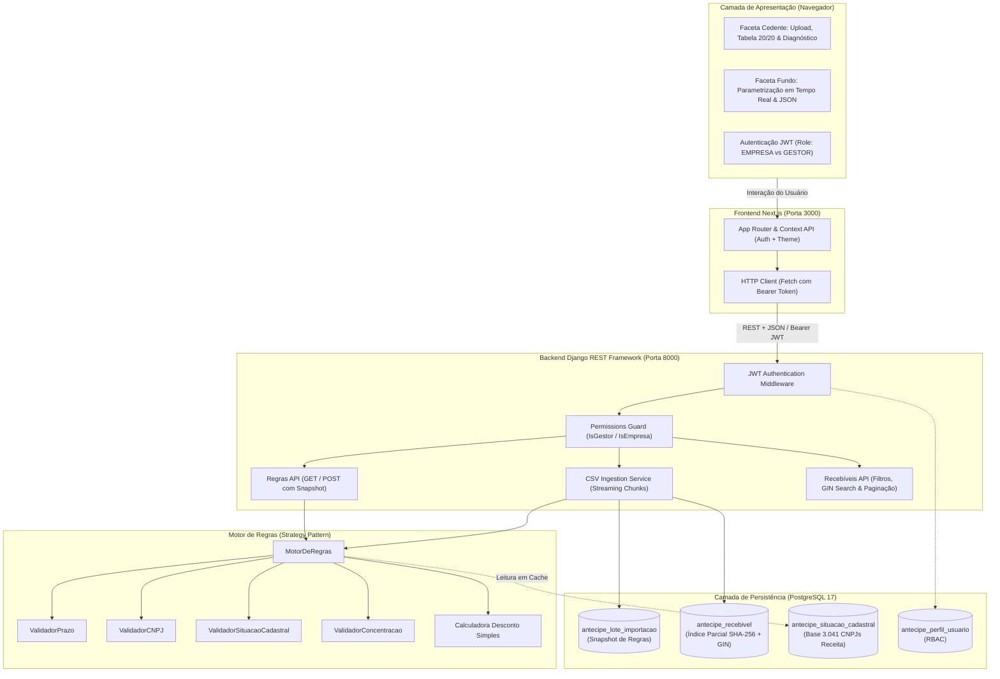
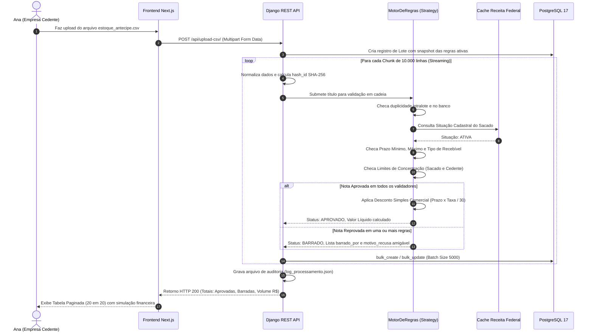

# Antecipe — Plataforma Inteligente de Antecipação de Recebíveis

> **"Importar. Decidir. Explicar. Simular."**  
> *Projeto desenvolvido para o Hackathon Kanastra 2026 pelos integrantes:*  
> **Giovanna Oliveira Martins**, **Maria Luísa Gabriel Domingues** e **Murilo Alves Beppler**.

---

## 📑 Sumário Executivo

- [1. Visão Geral e Valor de Negócio](#1-visão-geral-e-valor-de-negócio)
- [2. Credenciais de Teste Padrão (Acesso Rápido)](#2-credenciais-de-teste-padrão-acesso-rápido)
- [3. Tech Stack & Ferramentas](#3-tech-stack--ferramentas)
- [4. Decisões de Arquitetura (System Design)](#4-decisões-de-arquitetura-system-design)
- [5. Diagramas de Fluxo e Arquitetura (Mermaid)](#5-diagramas-de-fluxo-e-arquitetura-mermaid)
- [6. CI/CD & Segurança (RBAC + JWT)](#6-cicd--segurança-rbac--jwt)
- [7. Guia de Execução Local (Passo a Passo)](#7-guia-de-execução-local-passo-a-passo)
- [8. Verificação Completa e Healthchecks (DevOps / SRE)](#8-verificação-completa-e-healthchecks-devops--sre)
- [9. Métricas e Auditoria da Base de Dados](#9-métricas-e-auditoria-da-base-de-dados)
- [10. Trabalhos Futuros](#10-trabalhos-futuros)

---

## 1. Visão Geral e Valor de Negócio

No ecossistema de crédito e securitização (FIDCs), a antecipação de recebíveis é vital para a sobrevivência do fluxo de caixa de micro, pequenas e médias empresas. Contudo, o mercado tradicional sofre de duas grandes dores estruturais:

1. **A Assimetria de Informação e a "Caixa-Preta" do Crédito (A Dor de Ana):**  
   Quando pequenas empresárias como a **Ana** enviam duplicatas para antecipação, muitas vezes recebem negativas genéricas ("Crédito recusado por critérios internos"). Sem entender a causa raiz — seja um prazo que excedeu o teto do fundo, uma inconsistência cadastral do sacado na Receita ou uma concentração de faturamento —, Ana fica sem capital de giro e sem capacidade de reação.  
   **A Solução Antecipe:** Transparência radical. Cada nota recusada recebe um diagnóstico explícito e amigável em linguagem natural (ex: *"Prazo de 210 dias excede o limite máximo permitido de 180 dias"*), permitindo que a empresa ajuste suas faturas e tome decisões conscientes.

2. **A Rigidez Operacional dos Gestores de Fundos:**  
   Mercados de capitais exigem agilidade regulatória e de governança. Quando o comitê de risco de um FIDC decide ajustar a taxa de desconto mensal ou alterar limites de concentração, soluções legadas demandam reuniões de TI, alterações de código e *deploys* arriscados em produção.  
   **A Solução Antecipe:** Um motor de regras dinâmico, baseado em parâmetros desacoplados (`JSON`), permitindo que o gestor ative, desative ou reajuste critérios de crédito em tempo real pela interface gráfica, com reavaliação instantânea e sem deploy de código.

---

## 2. Credenciais de Teste Padrão (Acesso Rápido)

Para facilitar a auditoria e a avaliação da banca avaliadora, o sistema já disponibiliza contas pré-configuradas com diferentes níveis de privilégio (RBAC). A tela de login (`/login`) dispõe inclusive de atalhos de 1-clique para preenchimento automático.

| Perfil / Papel | Usuário | Senha | Escopo de Acesso na Plataforma |
| :--- | :--- | :--- | :--- |
| **Administrador Geral** | `admin` | `password123` | **Super Gestor / População:** Acesso exclusivo ao dropzone de importação massiva (CSV) na dashboard principal para popular o sistema, criando ou atualizando automaticamente contas de cedentes e fundos com sincronização de senhas. |
| **Cedente (Empresa)** | `cedente_demo` | `password123` | **Faceta do Cedente:** Upload interno de arquivos CSV para a própria conta, listagem paginada (20/20 com saltos diretos e páginas vizinhas), ordenação por toggle em cada coluna, detalhamento com explicação de recusas, simulação financeira em tempo real. Bloqueado de alterar regras do fundo (`403 Forbidden`). |
| **Fundo (Gestor)** | `gestor_demo` | `password123` | **Acesso Completo:** Todas as funções da empresa + **Área dos Fundos:** Visualização da carteira sob gestão com ordenação em todas as colunas, parametrização em tempo real das regras do FIDC, alteração de taxas de desconto mensal, importação/exportação de JSON e recálculo instantâneo de liquidez. |

> *Nota:* Usuários alternativos adicionais disponíveis: `empresa_demo` (Empresa) e `fundo_demo` (Gestor), ambos com a senha `password123`. A conta `admin` é reservada para administração e não possui atalho rápido de preenchimento na tela de login por motivos de segurança.

---

## 3. Tech Stack & Ferramentas

```text
┌────────────────────────────────────────────────────────────────────────┐
│                        ARQUITETURA TECNOLÓGICA                         │
├─────────────────────┬──────────────────────────────────────────────────┤
│ Frontend Web App    │ Next.js 16.4 (App Router) + React 19 + TypeScript│
│ Estilização & UI    │ Tailwind CSS (Design System Kanastra: #0B2C20)   │
│ Backend API         │ Python 3.12 + Django 5.1 + Django REST Framework │
│ Gerenciador Pacotes │ uv (Astral) no Backend & pnpm / npm no Frontend  │
│ Autenticação & Auth │ SimpleJWT (JSON Web Tokens) com RBAC Customizado │
│ Banco de Dados      │ PostgreSQL 17 (Índices GIN, B-Tree e Parciais)   │
│ Testes Automatizados│ Django Test Runner (17 testes unitários / 100%)  │
│ CI/CD Pipeline      │ GitHub Actions (Docker Postgres 17 + Python + JS)│
│ Conteinerização     │ Docker + Docker Compose                          │
└─────────────────────┴──────────────────────────────────────────────────┘
```

---

## 4. Decisões de Arquitetura (System Design)

A arquitetura do **Antecipe** foi desenhada para resolver os gargalos clássicos de sistemas financeiros: escalabilidade na ingestão massiva, integridade de dados sob alta concorrência e flexibilidade para regras de crédito que mudam frequentemente.

### 4.1. Padrão Strategy para Validadores Dinâmicos
Em vez de implementar regras com encadeamentos de condicionais `if/else` engessados, o motor de regras adota o **Design Pattern Strategy**:
- A classe abstrata `BaseValidador` estabelece o contrato comum (`validar(recebivel, contexto)`).
- Cada regra do catálogo (ex: `ValidadorPrazoMaximo`, `ValidadorValorMinimo`, `ValidadorSituacaoCadastralSacado`, `ValidadorConcentracaoSacado`) é um módulo isolado e testável.
- Um registro dinâmico (`REGISTRY_VALIDADORES`) instancia apenas as regras habilitadas na configuração ativa (`validadores_antecipe.json`).
- O `ContextoValidacao` mantém o estado global de validação em memória (totalizadores de carteira, base em cache de 3.041 situações cadastrais da Receita e conjunto de *hashes* intralote), garantindo complexidade $O(1)$ na maioria das consultas.

### 4.2. Processamento de CSV em Streaming e Chunks (Memory Safety)
Bases de recebíveis podem conter centenas de milhares de linhas (o arquivo oficial de teste possui 100.554 registros). Carregar todas as linhas em memória resultaria em estouro de RAM (*Out-Of-Memory Kill*):
- O serviço `core/services.py` utiliza `csv.DictReader` em streaming sequencial de disco.
- Os registros são agrupados em **chunks de até 10.000 linhas**.
- A persistência no PostgreSQL é realizada via `Recebivel.objects.bulk_create(..., batch_size=5000)`, mantendo a pegada de memória do container estável abaixo de **180 MB**, mesmo processando 600 milhões de reais em recebíveis.

### 4.3. Prevenção de Duplicatas, Idempotência e Race Conditions
Para assegurar que o mesmo recebível não seja pago duas vezes, a identificação do título é normalizada criptograficamente:
$$\text{hash\_id} = \text{SHA-256}(\text{doc\_cedente} \parallel \text{doc\_sacado} \parallel \text{nu\_documento} \parallel \text{vencimento})$$

- **Por que incluir o vencimento?** Contratos e Cédulas de Crédito Bancário (CCBs) operam com parcelas que compartilham o mesmo número de documento. Sem o vencimento, parcelas legítimas seriam descartadas como duplicatas falsas.
- **Índice Único Parcial:** No PostgreSQL, aplicamos `UniqueConstraint(fields=['hash_id'], condition=Q(status='APROVADO'))`. Isso permite que notas rejeitadas fiquem registradas para fins de auditoria, mas impede a nível de motor relacional qualquer concorrência que tente aprovar a mesma nota mais de uma vez.
- **Regra de Negócio de Duplicata com Promoção:** Se uma nota já foi submetida e rejeitada, e for reenviada em um novo lote onde agora cumpre as diretrizes, o sistema atualiza o registro existente para `APROVADO`, calculando seu desconto sem duplicar linhas.

### 4.4. Precificação Financeira: Desconto Simples Comercial
A precificação segue a regra padrão de mercado financeiro configurada no motor:
$$\text{Prazo (dias)} = \text{Data de Vencimento} - \text{Data de Aquisição}$$
$$\text{Taxa Efetiva} = \text{Taxa Mensal} \times \left( \frac{\text{Prazo (dias)}}{30} \right)$$
$$\text{Desconto} = \text{Valor Nominal} \times \text{Taxa Efetiva}$$
$$\text{Valor Líquido} = \text{Valor Nominal} - \text{Desconto}$$

### 4.5. População do Sistema e Sincronização Dinâmica de Usuários
Para permitir a simulação completa de ecossistemas com múltiplos cedentes e fundos:
- **Área Exclusiva de População (`admin`):** O upload de CSV massivo da tela inicial é reservado ao usuário administrador (`admin` / `password123`).
- **Geração Automática de Contas:** Durante a ingestão de cada lote, o serviço varre os pares únicos de Cedente e Fundo. Caso ainda não possuam conta no Django Auth, são gerados automaticamente usuários com o padrão de senha `123456` (ex: `cedente_<doc>` com papel `EMPRESA` e `fundo_<doc>` com papel `GESTOR`).
- **Preservação de Cadastros Pré-existentes:** Se um cedente ou fundo já possuir cadastro na base, sua senha e credenciais são estritamente mantidas intactas, e os recebíveis associados do CSV passam a pertencer diretamente à sua conta prévia.
- **Upload Operacional Interno:** Usuários autenticados de empresas cedentes possuem um botão interno de envio na tabela de recebíveis para submeter seus próprios lotes complementares.

---

## 5. Diagramas de Fluxo e Arquitetura (Mermaid)

### 5.1. Arquitetura de Alto Nível do Sistema



---

### 5.2. Sequence Diagram: Ciclo de Vida e Decisão de um Recebível



---

## 6. CI/CD & Segurança (RBAC + JWT)

### 6.1. Pipeline de Integração Contínua (GitHub Actions)
Toda alteração de código enviada para o repositório dispara o fluxo automatizado em `.github/workflows/pipeline.yml`, garantindo a confiabilidade da aplicação antes de qualquer entrega:
1. **Ambiente de Testes Isolado:** Sobe um container de serviço com **PostgreSQL 17** em rede dedicada.
2. **Setup Python 3.12:** Instala dependências usando `uv`, aplica migrações e executa a base de testes unitários (`python manage.py test core`).
3. **Setup Node.js 20:** Instala pacotes do frontend e executa o build estático de produção do Next.js (`pnpm build`), validando a integridade das rotas, TypeScript e componentes.

### 6.2. Matriz de Segurança e Permissões (RBAC)

A plataforma implementa controle de acesso rigoroso por meio de permissões customizadas do Django REST Framework:

```text
┌───────────────────────────┬───────────────┬───────────────────────────────┐
│ Rota / Recurso            │ Perfil EMPRESA│ Perfil GESTOR (Fundo FIDC)    │
├───────────────────────────┼───────────────┼───────────────────────────────┤
│ GET  /api/recebiveis/     │ Permitido     │ Permitido                     │
│ POST /api/upload-csv/     │ Permitido     │ Permitido                     │
│ GET  /api/regras/         │ 403 Forbidden │ Permitido (Consulta regras)   │
│ POST /api/regras/         │ 403 Forbidden │ Permitido (Edição de regras)  │
│ Botão Área dos Fundos   │ Desabilitado  │ Habilitado e navegável        │
└───────────────────────────┴───────────────┴───────────────────────────────┘
```

---

## 7. Guia de Execução Local (Passo a Passo)

Siga os comandos abaixo para subir o ambiente completo a partir do zero.

### Pré-requisitos
- [Docker](https://docs.docker.com/get-docker/) e Docker Compose
- [uv](https://docs.astral.sh/uv/) (recomendado para Python) ou Python 3.12+
- [Node.js 20+](https://nodejs.org/) e [pnpm](https://pnpm.io/) (ou npm)

### 1. Clonar o Repositório e Configurar Variáveis
```bash
git clone https://github.com/murilobeppler/Magimu-HACKATON-KANASTRA.git
cd Magimu-HACKATON-KANASTRA
cp .env.example .env
```

### 2. Subir o Banco de Dados (PostgreSQL 17)
```bash
docker compose up -d --wait
```

### 3. Configurar e Inicializar o Backend
```bash
cd backend

# Instala dependências e aplica migrações no banco
uv sync
uv run python manage.py migrate

# Carrega a base de 3.041 situações cadastrais da Receita (cnpj_situacao_mock.csv)
uv run python manage.py carregar_situacao_cadastral

# Cria as credenciais padrão de teste (admin, cedente_demo e gestor_demo com senha 'password123')
uv run python manage.py seed_test_users

# Executa os testes automatizados
uv run python manage.py test core

# Inicia o servidor da API (Porta 8000)
uv run python manage.py runserver 0.0.0.0:8000
```

> *Nota (Sem uv):* Caso prefira usar `pip`, utilize `pip install -r requirements.txt` e execute com `python manage.py <comando>`.

### 4. Configurar e Inicializar o Frontend
Em outro terminal, a partir da raiz do projeto:
```bash
cd frontend

# Instala dependências e inicia o servidor de desenvolvimento
pnpm install
pnpm dev
```
Acesse a aplicação no navegador em: **[http://localhost:3000](http://localhost:3000)**.

---

## 8. Verificação Completa e Healthchecks (DevOps / SRE)

Para auditar e certificar a saúde, a performance e a integridade de ponta a ponta do **Antecipe** nos momentos de avaliação e homologação, disponibilizamos um utilitário automatizado de terminal via [`healthcheck.sh`](./healthcheck.sh) e [`Makefile`](./Makefile).

### 8.1. Auditoria Global Completa (Comando Único)

Com os serviços iniciados, execute a auditoria global completa a partir da raiz do projeto:

```bash
# Via script bash nativo:
./healthcheck.sh all

# Ou via Makefile:
make audit-all
```

Este comando orquestra sequencialmente 4 baterias de validação automática:
1. **[1/4] Portas e Inicialização de Serviços:** Realiza pings HTTP no Backend Django (`http://localhost:8000/api/recebiveis/`) e no Frontend Next.js (`http://localhost:3000/`), além de consultar o PostgreSQL via `showmigrations` para certificar que **100% das migrações estão aplicadas**.
2. **[2/4] Suíte de Testes com Saída Visual e Cobertura:** Dispara o `pytest -v --color=yes --cov=core` exibindo o status individual de cada teste unitário e o relatório de cobertura de código das regras de negócio.
3. **[3/4] Build de Produção do Frontend:** Executa `next build` no Next.js para garantir que não há erros de tipagem TypeScript ou de sintaxe quebrando o deploy.
4. **[4/4] Verificação CI/CD:** Checa o status da pipeline no GitHub Actions (via GitHub CLI `gh` ou fallback para a API pública do GitHub).
5. **[Diagnóstico SRE] Logs Recentes de Performance:** Lê o arquivo `backend/logs/performance_profile.log` e exibe o tempo total gasto na ingestão de CSV, tempo de CPU, queries executadas e operações de `bulk_create`.

---

### 8.2. Comandos de Verificação Segmentada

Caso deseje auditar apenas uma etapa específica do sistema:

```bash
# 1. Verifica apenas a saúde das portas (8000, 3000) e migrações do banco
./healthcheck.sh ports        # ou: make check-ports

# 2. Roda apenas a suíte de testes com cores e cobertura (Pytest)
./healthcheck.sh tests        # ou: make test-visual

# 3. Valida apenas a compilação e tipagem estática do Frontend
./healthcheck.sh build        # ou: make build-front

# 4. Consulta apenas o status da pipeline de CI/CD
./healthcheck.sh ci           # ou: make check-ci

# 5. Exibe os últimos logs de profiling de performance da ingestão
./healthcheck.sh perf         # ou: make perf-logs
```

---

### 8.3. Profiling de Performance e Queries (`utils/profiler.py`)

A função de processamento de CSV possui o decorador `@profile_performance` injetado, que intercepta cada query via `connection.execute_wrapper` e calcula o throughput de ingestão:

```text
┌───────────────────────── PERFORMANCE PROFILE ─────────────────────────┐
│ Operação: Ingestão CSV & Validação em Lote                           │
│ Tempo Total: 4.8210s (CPU: 3.9100s | BD: 0.9110s)                    │
│ Queries Executadas: 24 queries (20 operações de bulk_create)         │
│ Throughput Ingestão: 20.850 linhas/s                                 │
└────────────────────────────────────────────────────────────────────────┘
```

Todos os eventos de profiling ficam registrados em formato estruturado (JSON Lines) em `backend/logs/performance_profile.log` para fins de auditoria SRE.

---

## 9. Métricas e Auditoria da Base de Dados

Durante o desenvolvimento, a base de teste oficial (`estoque_antecipe.csv`) com **100.554 títulos** foi submetida a auditoria computacional completa:

| Indicador / Métrica | Valor Apurado | Diagnóstico & Parecer Técnico |
| :--- | :--- | :--- |
| **Total de Recebíveis Auditados** | 100.554 | 100% de preenchimento; nenhuma célula em branco nas colunas obrigatórias. |
| **Valor Nominal Consolidado** | R$ 604.931.711,69 | 100% dos títulos apresentam valores positivos e estritamente numéricos. |
| **Prazo Médio (Duration Bruta)** | 111,2 dias | Prazos operacionais consistentes; nenhum título adquirido já vencido. |
| **Cedentes Únicos** | 122 | Relação 1:1 estrita entre Razão Social e CNPJ cadastrado. |
| **Sacados Únicos (CNPJ)** | 4.209 | 3.940 nomes empresariais para 4.209 CNPJs (269 filiais ativas na carteira). |
| **Duplicidades Reais** | 0 registros | Zero duplicatas integrais ou ocultas (mesmo sacado, valor e vencimento). |
| **Contratos Multiparcelas** | 9.657 títulos | Documentos com mais de um registro referente a parcelas com datas distintas (CCBs e NCs). |
| **Segregação de Fundos** | 18 FIDCs | A planilha agrega 18 fundos diferentes em uma única base de dados. |
| **Nota de Qualidade dos Dados** | **8,5 / 10** | Base íntegra; tratada para segregação adequada por fundo via interface. |

---

## 10. Trabalhos Futuros

1. **Mensageria Assíncrona e Arquitetura Orientada a Eventos:**  
   Substituir a ingestão HTTP direta por uma fila de eventos distribuída baseada em **NATS** ou **Apache Kafka**, associada a workers Celery, viabilizando o upload de arquivos de milhões de linhas com atualização de progresso em tempo real via WebSockets/SSE.
2. **Integração com a SEFAZ para Validação de NF-e:**  
   Consumir a API nacional da Receita Federal e SEFAZ para verificar o manifesto do destinatário, atestando se a mercadoria ou serviço da nota fiscal foi efetivamente entregue antes da cessão do crédito.
3. **Score de Crédito Inteligente com Machine Learning:**  
   Treinar modelos preditivos de *default* a partir do histórico de pontualidade de pagamento dos sacados, calculando uma taxa de desconto personalizada e orientada ao risco de cada devedor.

---
*Magimu Antecipe — Segurança institucional para o fundo, liquidez e transparência para a empresa.*

